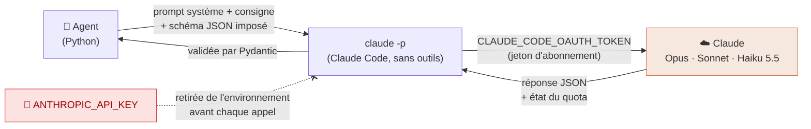
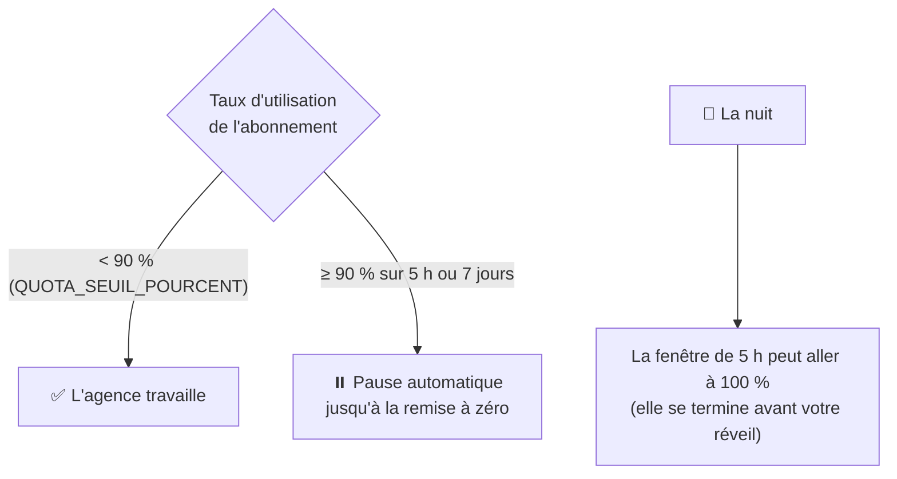
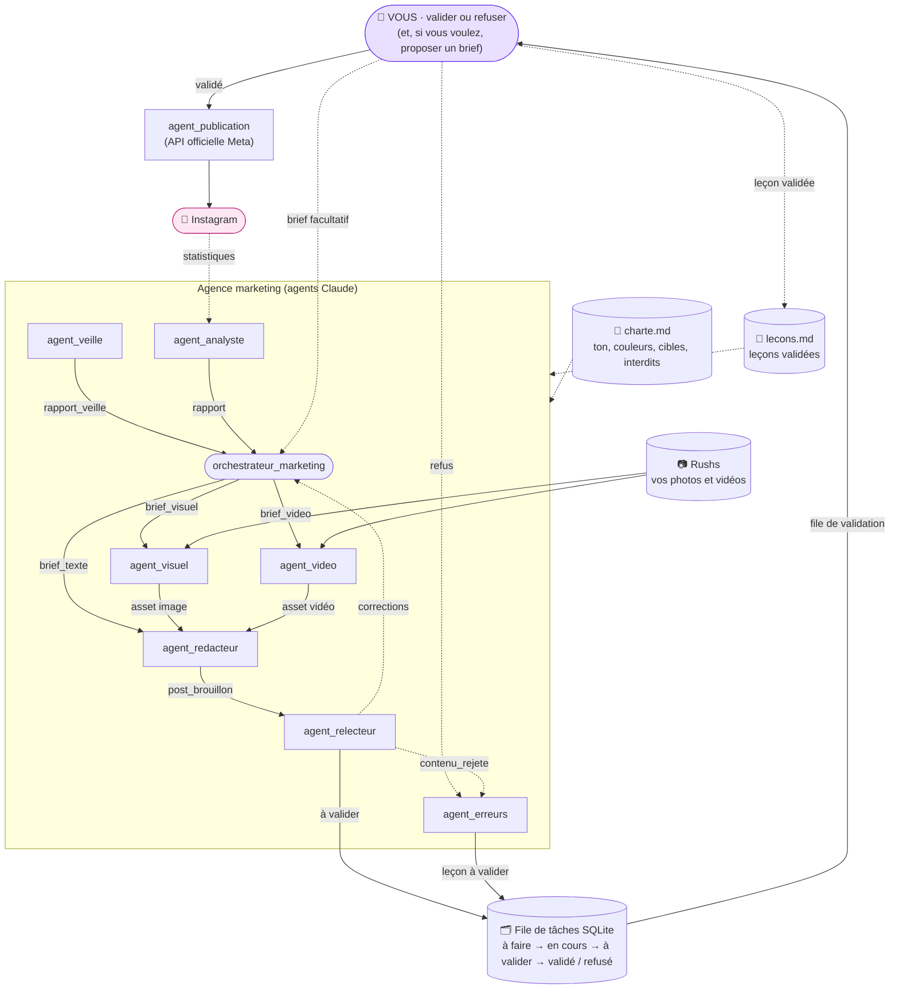
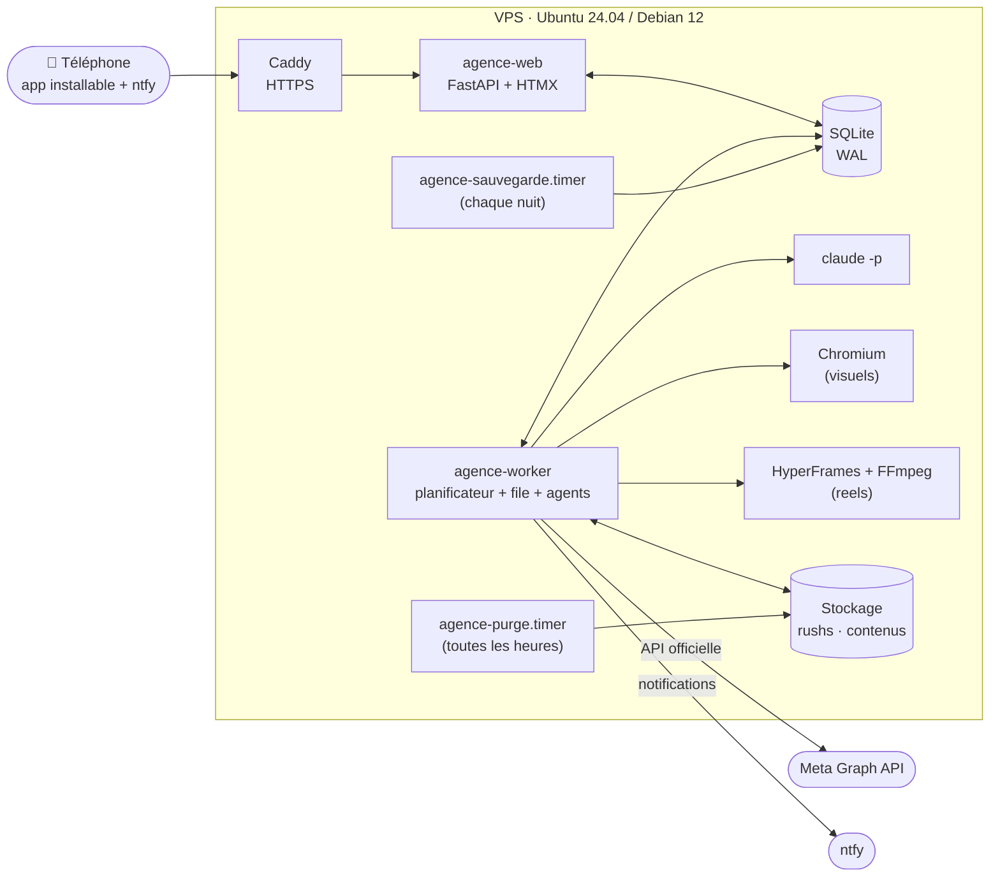
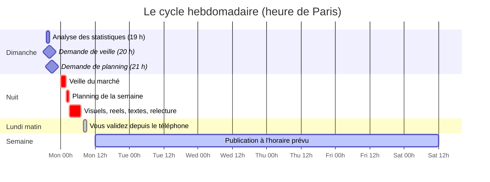
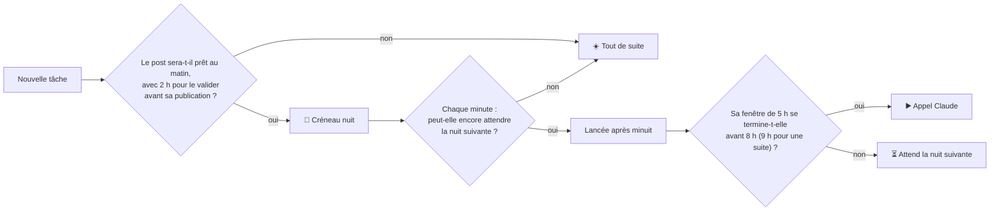
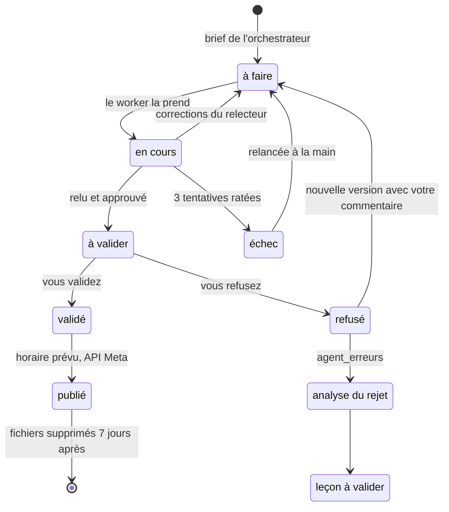
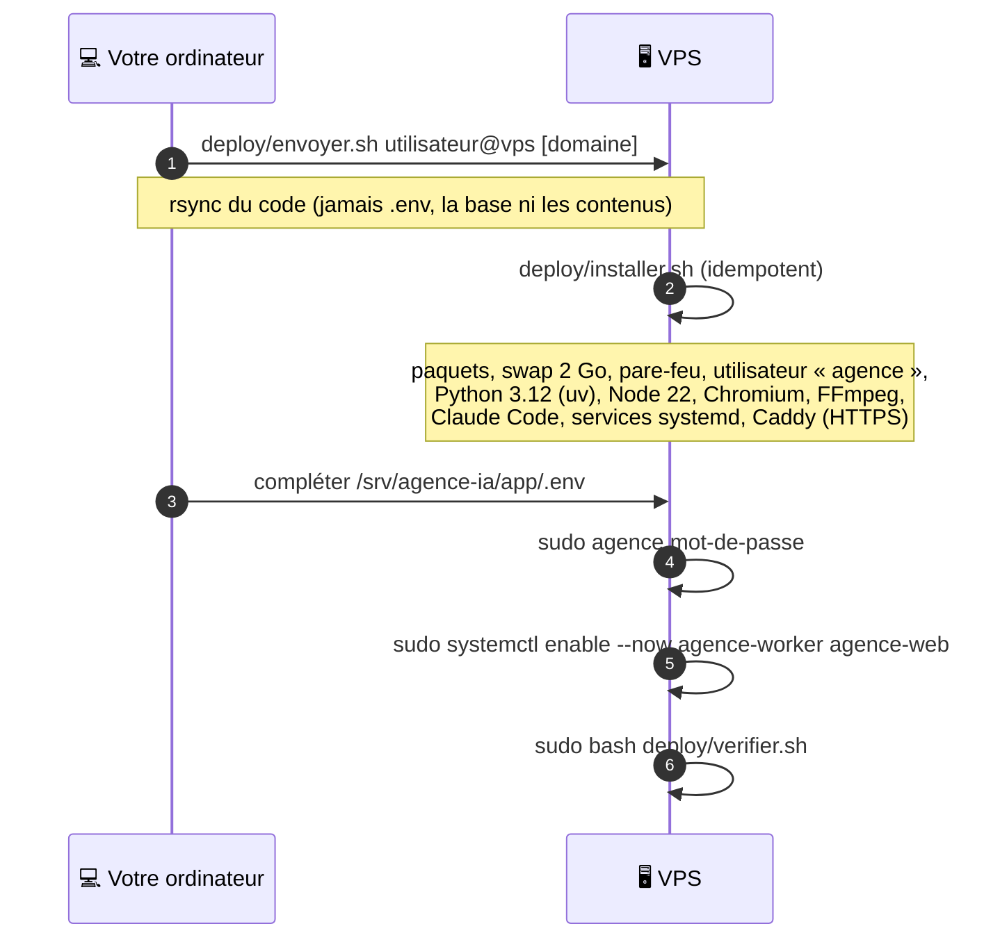
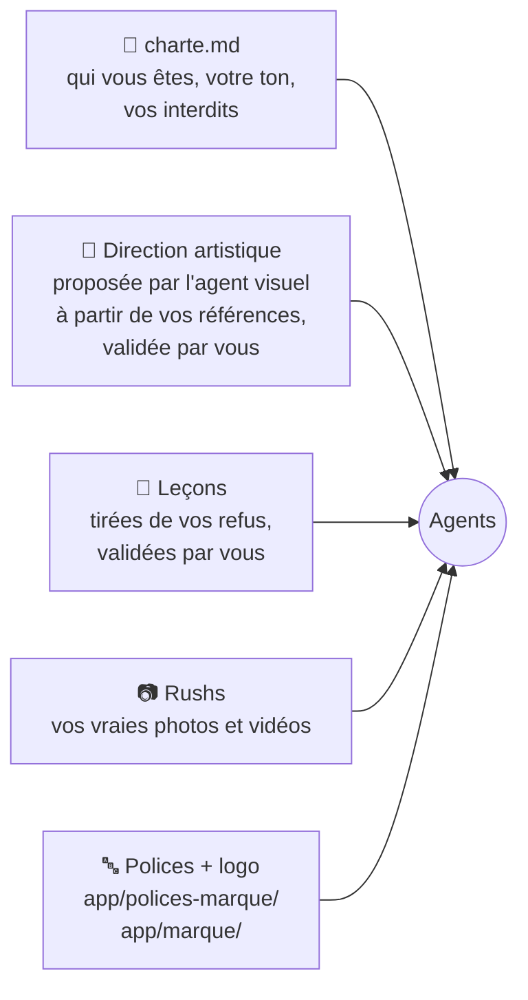

<div align="center">

# 🌙 Noctua

**Une agence marketing autonome, faite d'agents Claude, qui travaille la nuit pendant que vous dormez.**
**Vous n'avez qu'une chose à faire : valider ou refuser.**


</div>

---

## Sommaire

1. [En bref](#-en-bref)
2. [Token-less : tout tourne sur l'abonnement Claude](#-token-less--tout-tourne-sur-labonnement-claude)
3. [Ce que fait l'agence](#-ce-que-fait-lagence)
4. [Architecture](#-architecture)
5. [Une semaine dans la vie de l'agence](#-une-semaine-dans-la-vie-de-lagence)
6. [La production de nuit](#-la-production-de-nuit)
7. [Le cycle de vie d'un post](#-le-cycle-de-vie-dun-post)
8. [L'interface](#-linterface)
9. [Installation locale](#-installation-locale-mac-ou-linux)
10. [Déploiement sur un VPS](#-déploiement-sur-un-vps)
11. [Configuration (.env)](#-configuration-env)
12. [Personnaliser l'agence à votre marque](#-personnaliser-lagence-à-votre-marque)
13. [Commandes](#-commandes)
14. [Structure du projet](#-structure-du-projet)
15. [Sécurité et garde-fous](#-sécurité-et-garde-fous)
16. [FAQ](#-faq)
17. [Licence](#-licence)

---

## ✨ En bref

Noctua est une **équipe d'agents IA** qui gère la présence Instagram d'une marque, de bout en bout :

| | |
|---|---|
| 🔎 **Veille** | analyse chaque semaine le marché et les concurrents (recherche web) |
| 🗓️ **Planning** | construit le calendrier éditorial de la semaine (4 posts par défaut) et rédige les briefs |
| 🎨 **Visuels** | crée images et carrousels en HTML/CSS, rendus en PNG par Chromium, puis relus par Claude lui-même |
| 🎬 **Reels** | compose des vidéos en motion design (HTML + GSAP, rendu HyperFrames), avec de vrais bruitages CC0 |
| ✍️ **Rédaction** | écrit les légendes, hashtags, horaires |
| 🧐 **Relecture** | vérifie charte, fautes et faits (rien d'inventé) avant de vous soumettre quoi que ce soit |
| 📈 **Analyse** | relève les statistiques Instagram et écrit un rapport hebdomadaire qui nourrit le planning suivant |
| 🧠 **Leçons** | chaque refus est analysé ; la leçon proposée n'est appliquée qu'après **votre** validation |
| 📤 **Publication** | publie à l'horaire prévu via l'**API officielle de Meta**, uniquement les posts validés |

Le tout tient sur un **VPS de 2 cœurs et 4 Go de RAM**, avec **une seule base SQLite**, **aucune clé API payante** et
**aucun robot navigateur**.

---

## 🔑 Token-less : tout tourne sur l'abonnement Claude

> **Noctua n'utilise aucune clé API Anthropic.** Chaque agent appelle Claude via **Claude Code** (`claude -p`),
> authentifié par **votre abonnement Claude Pro ou Max**. Pas de facturation au token, pas de mauvaise surprise
> sur la facture : le coût de l'IA, c'est votre abonnement, point.

### Comment ça marche



1. **Un jeton d'abonnement**, généré une fois avec `claude setup-token` (valable un an), est rangé dans `.env`
   sous `CLAUDE_CODE_OAUTH_TOKEN`.
2. **Chaque appel est isolé** : dossier de configuration Claude réservé à l'agence, dossier de travail vide,
   aucune session enregistrée, aucun serveur MCP, aucune commande slash, pas d'outil (sauf la recherche web pour
   la veille, et la lecture du rendu pour que Claude regarde ses propres visuels).
3. **La réponse est imposée** par un schéma JSON (`--json-schema`), puis revérifiée par Pydantic.
4. **Toute clé API est retirée** de l'environnement avant l'appel (`ANTHROPIC_API_KEY`, `ANTHROPIC_AUTH_TOKEN`,
   `ANTHROPIC_BASE_URL`…) : impossible de basculer par erreur sur une facturation à l'usage.

### Respecter votre abonnement (et vous laisser en profiter)

L'abonnement sert aussi à **vous**. Noctua le ménage :



- Le quota de l'abonnement (fenêtres de **5 heures** et de **7 jours**) est lu dans le flux de chaque réponse et
  affiché dans l'interface.
- Les tâches gourmandes sont faites **la nuit** (voir [La production de nuit](#-la-production-de-nuit)) : votre
  fenêtre de 5 heures de la journée vous reste.
- **Choix du modèle par tâche** : l'orchestrateur précise pour chaque tâche le modèle et l'effort adaptés
  (Haiku pour le mécanique, Sonnet pour l'analyse et la relecture, **Opus toujours pour la création de contenu**).

> ℹ️ Un plafond de dépenses (`PLAFOND_COUTS_MENSUEL_USD`, 0 par défaut) existe pour d'éventuelles API payantes
> futures : à 0, **aucun appel payant n'est possible**.

---

## 🧩 Ce que fait l'agence

| Agent | Modèle par défaut | Reçoit | Produit |
|---|---|---|---|
| `orchestrateur_marketing` | Opus 5.5 | demande de planning, rapport de veille, rapport de l'analyste, leçons, brief facultatif | calendrier de la semaine + briefs (visuel, vidéo, texte), avec modèle et effort pour chacun |
| `agent_veille` | Opus 5.5 + recherche web | déclenchement hebdomadaire | rapport de veille : concurrents, formats et angles qui marchent, recommandations, sources |
| `agent_visuel` | Opus 5.5 + Chromium | brief visuel, rushs, charte, direction artistique, références | image ou carrousel PNG (et le HTML utilisé) |
| `agent_video` | Opus 5.5 + HyperFrames | brief vidéo, rushs, charte | reel MP4 (1080×1920) + script |
| `agent_redacteur` | Opus 5.5 | brief texte + médias | post complet : légende, médias, réseau, horaire |
| `agent_relecteur` | Sonnet 5.5 | post brouillon | « à valider », ou corrections renvoyées à l'orchestrateur |
| `agent_erreurs` | Sonnet 5.5 | tout contenu rejeté | leçon proposée (à valider par vous) |
| `agent_analyste` | Sonnet 5.5 | statistiques Instagram | rapport hebdomadaire lu par l'orchestrateur |
| `agent_publication` | aucun (API Meta) | post validé dont l'horaire arrive | post publié, avec date et lien |

---

## 🏗️ Architecture

Les agents **ne s'appellent jamais directement** : chaque flèche est un **message typé** (Pydantic) écrit dans une
**file de tâches** SQLite partagée. Un seul *worker* dépile les tâches, une à la fois.



### Les processus



**Choix techniques, tous dictés par la légèreté (2 cœurs, 4 Go) :**

- **7 dépendances Python** seulement : `pydantic`, `python-dotenv`, `fastapi`, `uvicorn`, `jinja2`,
  `python-multipart`, `pillow`.
- **SQLite** pour tout (file de tâches, contenus, coûts, leçons, statistiques), schéma versionné par migrations.
- **HTMX** côté interface : pas de framework JavaScript, pas de build.
- **Un seul rendu à la fois** (image ou vidéo), via la file de tâches.
- **Module `stockage`** unique pour tous les fichiers : passer plus tard à S3 ne touchera pas les agents.

---

## 📅 Une semaine dans la vie de l'agence



1. **Dimanche 19 h** : l'analyste relève les statistiques et écrit son rapport.
2. **Dimanche soir** : veille et planning sont demandés, puis **confiés à la nuit**.
3. **Après minuit** : veille → planning → visuels, reels, textes, relecture.
4. **Au réveil** : une notification sur le téléphone. Vous validez ou refusez chaque post.
5. **Pendant la semaine** : chaque post validé part **tout seul** à son horaire (entre 8 h et 22 h).

Si l'agence était arrêtée à l'heure prévue, la tâche est rattrapée à son redémarrage (une seule fois). Au tout
premier démarrage, rien n'est lancé, pour ne pas consommer l'abonnement par surprise.

---

## 🌙 La production de nuit

Chaque tâche a un **créneau** : `jour` (à tout moment), `nuit` (peut attendre la nuit) ou `nuit_suite` (suite d'une
chaîne commencée la nuit).



**La règle de la fenêtre** : la nuit, un appel n'est lancé que si la fenêtre de 5 heures qui le contient se termine
avant `ABONNEMENT_LIBRE` (8 h). Résultat : **aucune fenêtre ouverte par l'agence ne déborde sur votre matinée.**

---

## 🔁 Le cycle de vie d'un post



**Conservation des fichiers** (pour un disque de 40 Go) :

| Quoi | Quand c'est supprimé |
|---|---|
| Fichiers de travail | juste après chaque tâche |
| Contenus publiés | 7 jours après publication |
| Rushs et contenus refusés ou « à ne pas utiliser » | en corbeille, supprimés sous 24 h, **après** leur analyse par `agent_erreurs` |
| Nouveau rush | refusé si le disque passe sous le seuil (`DISQUE_SEUIL_REFUS_GO`) |

---

## 📱 L'interface

Une application web **installable sur le téléphone** (écran d'accueil iPhone et Android), protégée par mot de passe.

| Page | Rôle |
|---|---|
| **Accueil** | ce qui attend votre validation, le travail des agents, quota, disque |
| **À valider** | posts, visuels, reels et leçons à valider ou refuser (avec commentaire) |
| **Calendrier** | publications prévues et tâches des agents, jour par jour ; téléchargement d'un post pour le publier à la main |
| **Aperçu du profil** | vos posts prévus placés devant vos derniers posts, comme sur Instagram |
| **Brief** | proposer vous-même une idée de post (facultatif) |
| **Agents** | qui travaille, sur quoi, et ce qui est prévu cette nuit |
| **Veille** | le dernier rapport de veille |
| **Statistiques** | portée, interactions, abonnés, et le rapport de l'analyste |
| **Leçons** | les leçons validées que tous les agents appliquent |
| **Recherche** | dans les légendes (posts de l'agence et Instagram), touche « / » |
| **Réglages** | direction artistique, références de style, rushs, banque de sons, corbeille, historique, échecs |

**Notifications push** sur le téléphone via [ntfy](https://ntfy.sh) (gratuit, sans compte), avec une plage de
silence la nuit : tout arrive en un message au réveil.

---

## 💻 Installation locale (Mac ou Linux)

Idéale pour essayer l'agence avant de la mettre sur un serveur.

### Prérequis

| Outil | Version | Pourquoi |
|---|---|---|
| Python | 3.12 ou plus | le cœur de l'agence |
| Node.js | 22 ou plus | le rendu des reels (HyperFrames) |
| FFmpeg | récent | montage audio et vidéo |
| Google Chrome ou Chromium | récent | le rendu des visuels |
| [Claude Code](https://docs.claude.com/fr/docs/claude-code/overview) | récent | la commande `claude` |
| Un abonnement **Claude Pro ou Max** | | c'est lui qui fait tourner les agents |

### Étapes

```bash
# 1. Récupérer le code
git clone https://github.com/LemonProg/noctua.git
cd noctua

# 2. Environnement Python
python3.12 -m venv .venv
source .venv/bin/activate
pip install -e .

# 3. Dépendances du rendu vidéo
(cd video && npm ci)

# 4. Configuration
cp .env.example .env
cp charte.exemple.md charte.md
```

**5. Adapter `.env` pour un usage local** : remplacez les chemins `/srv/...` par des chemins dans le projet, par
exemple :

```dotenv
NOM_AGENCE=Ma marque
DOSSIER_CONTENUS=donnees/contenus
DOSSIER_TEMP=donnees/tmp
CHEMIN_BASE=donnees/agence.sqlite3
DOSSIER_SAUVEGARDES=donnees/sauvegardes
DOSSIER_CONFIG_CLAUDE=donnees/claude-config
```

**6. Brancher votre abonnement Claude** (aucune clé API) :

```bash
claude setup-token        # ouvre le navigateur, connexion avec votre compte Claude
# copiez le jeton affiché dans .env :  CLAUDE_CODE_OAUTH_TOKEN=...
```

**7. Remplir `charte.md`** : remplacez chaque `[À REMPLIR]`. Tant qu'il en reste un, les agents refusent de
démarrer (voir [Personnaliser l'agence](#-personnaliser-lagence-à-votre-marque)).

**8. Initialiser et lancer** :

```bash
agence mot-de-passe       # mot de passe de l'interface (haché dans .env)
agence init               # crée la base et les dossiers, vérifie la charte
agence web                # interface sur http://127.0.0.1:8000
python -m noyau.worker    # dans un second terminal : les agents au travail
```

> 💡 Pour ouvrir l'interface depuis votre téléphone sur le même Wi-Fi, mettez `HOTE_WEB=0.0.0.0`.

---

## 🚀 Déploiement sur un VPS

Cible : **Ubuntu 24.04 ou Debian 12**, 2 cœurs, 4 Go de RAM, 40 Go de disque, accès SSH avec `sudo`.



### En pratique

```bash
# Depuis votre ordinateur, à la racine du projet (avec charte.md rempli)
deploy/envoyer.sh utilisateur@adresse-du-vps agence.mondomaine.fr
```

Puis sur le VPS :

```bash
sudo -u agence nano /srv/agence-ia/app/.env    # CLAUDE_CODE_OAUTH_TOKEN, Instagram, etc.
sudo agence mot-de-passe
sudo systemctl enable --now agence-worker agence-web
sudo bash /srv/agence-ia/app/deploy/verifier.sh   # vérifie le circuit complet sur une base d'essai
```

Le script d'installation peut être relancé sans risque à chaque mise à jour. Il installe aussi :

- **Caddy** et le **HTTPS automatique** si un domaine est donné (ports 80 et 443 ouverts, sinon seul SSH l'est) ;
- la **purge horaire** de la corbeille et des contenus publiés ;
- la **sauvegarde quotidienne** de la base (7 copies gardées), à rapatrier avec `deploy/recuperer-sauvegardes.sh`.

Optionnel, une fois installé :

```bash
sudo agence sons importer              # ~75 vrais bruitages CC0 depuis Openverse
sudo agence video banc --durees 15 30 60   # mesure temps de rendu et mémoire des reels
sudo agence notification sujet         # active les notifications push (ntfy)
```

Le détail complet est dans [`deploy/LISEZMOI.md`](deploy/LISEZMOI.md).

### Brancher Instagram (facultatif)

1. Un **compte Instagram professionnel** et une **app Meta** (developers.facebook.com).
2. Dans `.env` : `INSTAGRAM_COMPTE_ID` et `INSTAGRAM_JETON` (jeton longue durée).
3. Un **domaine en HTTPS** (`URL_PUBLIQUE`) : Meta vient y chercher les médias à publier, exposés le temps de la
   publication sous un nom aléatoire, puis supprimés.
4. `PUBLICATION_AUTOMATIQUE=oui` quand tout est prêt.

Sans Instagram branché, l'agence fonctionne quand même : chaque post validé se **télécharge** depuis le calendrier
et se publie à la main (« Marquer comme posté »).

---

## ⚙️ Configuration (`.env`)

Le fichier [`.env.example`](.env.example) contient l'essentiel. Toutes les erreurs de configuration sont
regroupées dans un seul message au démarrage, pour tout corriger en une fois.

| Variable | Rôle |
|---|---|
| `NOM_AGENCE` | nom affiché dans l'interface, l'app installée et les notifications |
| `DOSSIER_CONTENUS` · `DOSSIER_TEMP` · `CHEMIN_BASE` · `DOSSIER_SAUVEGARDES` | où vivent fichiers, base et sauvegardes |
| `DISQUE_SEUIL_ALERTE_GO` · `DISQUE_SEUIL_REFUS_GO` | alerte, puis refus des nouveaux rushs, quand le disque se remplit |
| `CORBEILLE_DELAI_HEURES` · `PUBLICATION_DELAI_JOURS` | conservation des fichiers |
| `PLAFOND_COUTS_MENSUEL_USD` | plafond des API payantes (0 = aucune) |
| `QUOTA_SEUIL_POURCENT` | pause de l'agence au-delà de ce taux d'utilisation de l'abonnement |
| `CLAUDE_CODE_OAUTH_TOKEN` | 🔐 jeton d'abonnement (`claude setup-token`) |
| `DOSSIER_CONFIG_CLAUDE` | configuration de Claude Code réservée à l'agence |
| `HOTE_WEB` · `PORT_WEB` | adresse d'écoute de l'interface |
| `MOT_DE_PASSE_INTERFACE` · `SECRET_SESSION` | 🔐 écrits par `agence mot-de-passe` |
| `NTFY_SUJET` | 🔐 sujet secret des notifications push |
| `PUBLICATION_AUTOMATIQUE` · `INSTAGRAM_API_URL` · `INSTAGRAM_COMPTE_ID` · `INSTAGRAM_JETON` | publication via l'API Meta |

<details>
<summary><b>Réglages facultatifs</b> (valeurs par défaut entre parenthèses)</summary>

| Variable | Rôle |
|---|---|
| `URL_PUBLIQUE` (vide) | adresse HTTPS publique, requise pour la publication automatique |
| `NUIT_DEBUT` (`00:00`) | début de la production de nuit |
| `ABONNEMENT_LIBRE` (`08:00`) | heure où l'abonnement doit être libre pour vous |
| `ABONNEMENT_LIBRE_MAX` (`09:00`) | retard toléré pour finir une chaîne commencée |
| `MARGE_VALIDATION_HEURES` (`2`) | temps laissé pour valider avant la publication |
| `NTFY_SERVEUR` (`https://ntfy.sh`) | serveur ntfy (le vôtre si vous en hébergez un) |
| `NOTIFICATIONS_SILENCE` (`22:00-08:00`) | plage sans notification |
| `SAUVEGARDES_CONSERVEES` (`7`) | nombre de sauvegardes gardées |
| `SON_CIBLE_LUFS` (`-16`) · `SON_CRETE_DBTP` (`-1.5`) | niveau sonore des reels |

</details>

> ⚠️ **Ne définissez jamais `ANTHROPIC_API_KEY`.** Claude Code l'utiliserait à la place de l'abonnement (et vous
> seriez facturé à l'usage). Noctua la retire de toute façon avant chaque appel.

---

## 🎨 Personnaliser l'agence à votre marque



1. **`charte.md`** (copié depuis [`charte.exemple.md`](charte.exemple.md)) : identité, offres, ton, couleurs,
   cibles, interdits, exemples de posts. **Les agents n'inventent rien** : ni prix, ni client, ni promesse absents
   de la charte ou d'un brief.
2. **Références de style** (Réglages > Références) : déposez des visuels que vous aimez ; l'agent visuel en tire une
   **direction artistique** que vous validez.
3. **Polices** : déposez vos fichiers `.woff2` dans `app/polices-marque/` (non versionné : beaucoup de licences de
   polices interdisent la redistribution).
4. **Logo** : déposez-le dans `app/marque/` ; les agents peuvent le citer dans leurs compositions.
5. **Rushs** : vos photos et vidéos (interface ou `agence rush ajouter`). Elles sont placées **telles quelles**,
   jamais redessinées ni « améliorées » par l'IA.
6. **Leçons** : à chaque refus, l'agence apprend, mais **seulement** après votre accord.

---

## 🛠️ Commandes

```text
agence init                       crée la base et les dossiers, vérifie la charte
agence web                        lance l'interface web
agence mot-de-passe               définit le mot de passe de l'interface
agence disque                     espace disque et alertes
agence purge                      supprime la corbeille échue et les contenus publiés anciens
agence sauvegarde                 sauvegarde compressée de la base

agence rush ajouter FICHIERS…     ajoute des photos ou vidéos
agence rush lister                liste les rushs disponibles
agence rush ecarter ID            met un rush en corbeille (« ne pas utiliser »)
agence corbeille lister           liste la corbeille
agence corbeille restaurer ID     sort un élément de la corbeille

agence tache creer …              ajoute un message à la file
agence tache lister               liste les tâches

agence statistiques releve        relève les statistiques Instagram (lecture seule)
agence notification sujet         crée le sujet ntfy secret
agence notification test          envoie une notification de test
agence sons importer              complète la banque de bruitages CC0 (Openverse)
agence sons lister                liste les sons utilisables
agence video banc --durees 15 30  banc de test du rendu des reels

python -m noyau.worker            le worker : planificateur, file de tâches, agents
```

---

## 📁 Structure du projet

```text
noctua/
├── agents/                 # un fichier par agent (orchestrateur, veille, visuel, video, redacteur…)
├── noyau/                  # le moteur
│   ├── claude.py           #   appel de Claude via l'abonnement (claude -p), sans clé API
│   ├── file.py             #   file de tâches SQLite
│   ├── messages.py         #   messages typés entre agents (Pydantic)
│   ├── worker.py           #   boucle principale
│   ├── planificateur.py    #   tâches hebdomadaires (analyse, veille, planning)
│   ├── creneaux.py         #   production de nuit
│   ├── quota.py            #   suivi du quota de l'abonnement
│   ├── stockage.py         #   accès unique aux fichiers (prêt pour S3)
│   ├── rendu.py            #   rendu HTML → PNG (Chromium)
│   ├── video.py            #   rendu des reels (HyperFrames) et niveau sonore
│   ├── banque_sons.py      #   bruitages CC0 (Openverse / Freesound)
│   ├── instagram.py        #   API officielle de Meta
│   ├── publication.py      #   publication à l'horaire prévu
│   ├── statistiques.py     #   relevé des statistiques
│   ├── purge.py            #   conservation et corbeille
│   └── …
├── app/                    # interface web (FastAPI + Jinja + HTMX)
│   ├── gabarits/           #   pages
│   ├── statique/           #   CSS, JS, icônes, police Geist
│   ├── marque/             #   votre logo
│   └── polices-marque/     #   vos polices (non versionné)
├── video/                  # HyperFrames + GSAP (versions figées)
├── deploy/                 # installation VPS, systemd, Caddy, vérification, sauvegardes
├── docs/architecture.md    # architecture détaillée des agents et des messages
├── charte.exemple.md       # modèle de charte de marque
├── .env.example            # configuration
└── CLAUDE.md               # règles du projet pour Claude Code
```

---

## 🛡️ Sécurité et garde-fous

| Garde-fou | Comment |
|---|---|
| **Rien ne sort sans vous** | seul un post `validé` peut être publié, une seule fois (noté en base juste avant l'appel irréversible) |
| **Aucun robot navigateur** | publication uniquement par l'API officielle de Meta : ni Playwright, ni session, ni identifiants stockés |
| **Aucune clé API** | les clés Anthropic sont retirées de l'environnement ; plafond de dépenses à 0 par défaut |
| **Rien d'inventé** | les agents n'utilisent que la charte et les briefs ; le relecteur vérifie les faits |
| **Pas d'IA sur vos photos** | les rushs sont placés tels quels (recadrage seulement) |
| **Sons libres** | bruitages **CC0 uniquement**, licence revérifiée sur la page Freesound de chaque son |
| **Interface protégée** | mot de passe haché (scrypt), cookie de session signé, limitation des tentatives, en-têtes de sécurité |
| **Secrets** | uniquement dans `.env`, jamais dans le code ni dans git |
| **Serveur** | utilisateur système dédié, services systemd durcis, pare-feu, HTTPS par Caddy |

---

## ❓ FAQ

<details>
<summary><b>Combien ça coûte ?</b></summary>

Votre abonnement Claude (Pro ou Max) et un petit VPS. Aucune API payante n'est utilisée par défaut. Un abonnement
Max laisse plus de marge pour la production hebdomadaire ; l'agence se met en pause d'elle-même avant d'épuiser
votre quota.
</details>

<details>
<summary><b>Est-ce que l'agence peut publier sans moi ?</b></summary>

Non. Valider un post vaut autorisation de le publier **à son horaire prévu**, et rien d'autre. Un post non validé
ne part jamais.
</details>

<details>
<summary><b>Et si mon ordinateur est éteint la nuit ?</b></summary>

En local, la production de nuit ne tourne que si la machine reste allumée ; sinon elle reprend au prochain
démarrage. Sur un VPS, elle tourne en permanence.
</details>

<details>
<summary><b>Pourquoi le français partout ?</b></summary>

Le projet a été conçu pour une marque francophone : interface, documentation, prompts et messages sont en
français. Les agents rédigent dans la langue de votre charte.
</details>

<details>
<summary><b>D'autres réseaux que Instagram ?</b></summary>

Le contenu produit (images, carrousels, reels, légendes) est réutilisable ailleurs en le téléchargeant depuis le
calendrier. Seule la publication automatique est propre à Instagram pour l'instant.
</details>

<details>
<summary><b>Est-ce conforme aux conditions de Claude ?</b></summary>

Noctua utilise Claude Code, l'outil officiel d'Anthropic, avec un jeton généré par `claude setup-token`, prévu
pour un usage non interactif. Restez dans un usage personnel de votre abonnement et respectez les conditions
d'utilisation d'Anthropic et de Meta.
</details>

---

## 📄 Licence

[MIT](LICENSE). Icônes [Phosphor](https://phosphoricons.com) (MIT), police [Geist](app/statique/polices/LICENCE.txt)
(SIL OFL), [HTMX](https://htmx.org) (0BSD), bruitages CC0 via [Openverse](https://openverse.org).

<div align="center">

**Fait avec 🌙 et Claude, sans un seul token facturé.**

</div>
