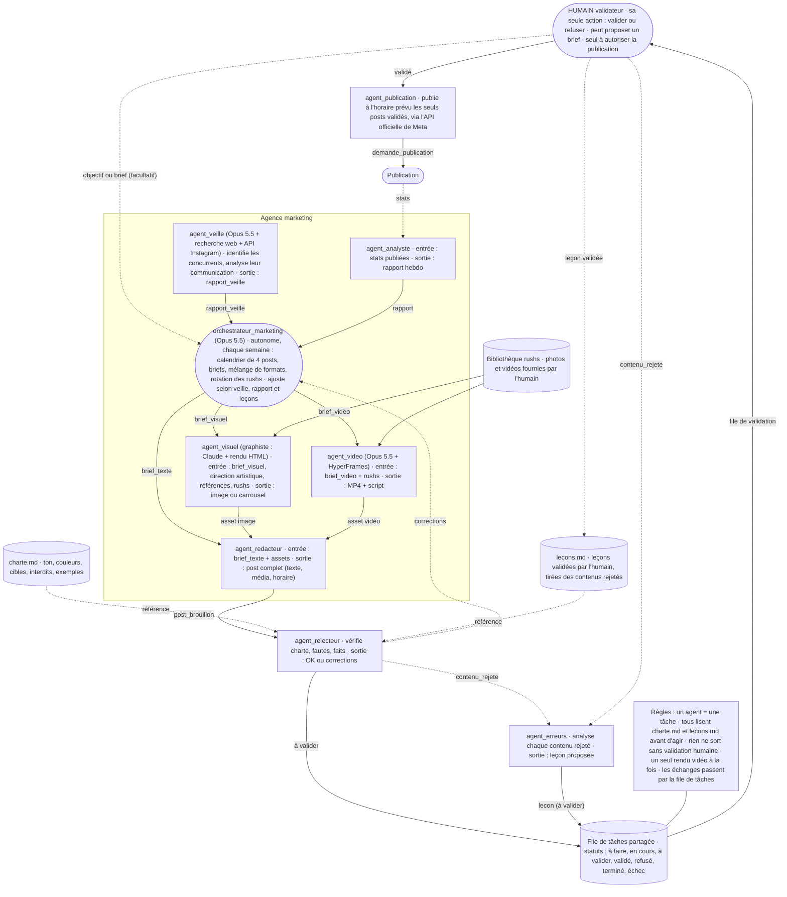

# Architecture des agents

## Principe

Une agence **marketing** (contenu organique pour Instagram) tourne sur un petit VPS : une équipe d'agents Claude produit, un humain valide.

Chaque flèche du schéma est un **message typé** écrit dans la **file de tâches partagée** et adressé à un agent. Les agents ne s'appellent pas directement : ils lisent leurs tâches dans la file et y écrivent leurs résultats.

## Schéma

## Agents

| ID | Agence | Modèle / outil | Reçoit | Produit |
|---|---|---|---|---|
| `orchestrateur_marketing` | Marketing | Opus 5.5 | déclenchement hebdomadaire, rapport_veille, rapport (analyste), corrections (relecteur), objectif ou brief facultatif (humain) | calendrier éditorial, brief_visuel, brief_video, brief_texte |
| `agent_veille` | Marketing | Opus 5.5 + recherche web + API Instagram | déclenchement périodique | rapport_veille |
| `agent_visuel` | Marketing | Opus 5.5 + rendu Chromium | brief_visuel + rushs + charte + direction artistique + références ; analyse_style | asset (image ou carrousel) + HTML utilisé ; direction artistique proposée |
| `agent_video` | Marketing | Opus 5.5 + HyperFrames | brief_video + rushs + charte | asset vidéo (MP4) + script |
| `agent_redacteur` | Marketing | Opus 5.5 | brief_texte + assets + charte | post_brouillon (texte, média, réseau, horaire) |
| `agent_analyste` | Marketing | Sonnet 5.5 (effort moyen par défaut) | demande_analyse (dimanche 19 h) + statistiques des posts (saisies, import Meta Business Suite, puis API) | rapport hebdo, lu par l'orchestrateur au planning |
| `agent_relecteur` | Marketing | Sonnet 5.5 (effort moyen par défaut) | post_brouillon + charte | « à valider » ou corrections |
| `agent_erreurs` | Marketing | Opus 5.5 | contenu_rejete + charte + lecons.md | lecon (proposée, à valider par l'humain) |
| `agent_publication` | Marketing | aucun modèle (API officielle de Meta) | demande_publication (post validé dont l'horaire est arrivé) | post publié sur Instagram, date et lien de publication |

## Messages (proposition, à ajuster)

| Message | De → Vers | Contenu minimal |
|---|---|---|
| `objectif` | humain → orchestrateur_marketing (facultatif) | but, période, réseaux |
| `demande_veille` | planificateur → agent_veille | période ; modèle et effort |
| `demande_planning` | planificateur ou humain → orchestrateur_marketing | semaine visée, nombre de posts ; modèle et effort |
| `rapport_veille` | agent_veille → orchestrateur_marketing | période, concurrents identifiés, formats et thèmes qui marchent, cadences observées, recommandations, sources |
| `brief_visuel` / `brief_video` / `brief_texte` | orchestrateur → agent | id, objectif, format, réseau, rushs à utiliser, date prévue |
| `asset` | agent visuel / vidéo → rédacteur | id du brief, type, fichier(s) (une image ou les slides d'un carrousel), prompt ou script |
| `analyse_style` | humain → agent_visuel | références de style à analyser ; produit une direction artistique à valider |
| `post_brouillon` | rédacteur → relecteur | texte, médias, réseau, horaire prévu |
| `corrections` | relecteur → orchestrateur | id, liste des problèmes |
| `rapport` | analyste → orchestrateur | période, chiffres clés, recommandations, synthèse, ce qui marche, ce qui ne marche pas (enregistré, lu par l'orchestrateur au planning) |
| `contenu_rejete` | relecteur / humain → agent_erreurs | id du contenu, origine du rejet (refus humain, « ne pas utiliser », corrections du relecteur), contenu, brief, commentaire ou corrections |
| `demande_analyse` | planificateur ou humain → agent_analyste | semaine visée, forcer (analyser même sans nouvelle statistique) ; modèle et effort |
| `demande_publication` | worker → agent_publication | id du post validé (créée quand son horaire prévu arrive, entre 8 h et 22 h) |
| `lecon` | agent_erreurs → humain (file de validation) | id du contenu, erreur identifiée, cause probable, règle à appliquer, agents concernés |

## Autonomie de l'agence marketing

- L'humain n'a qu'une action : valider ou refuser. Il peut aussi proposer un brief, sans que ce soit nécessaire.
- `agent_veille` tourne régulièrement : il identifie lui-même les principaux concurrents (recherche web, API officielle de Meta pour les comptes Instagram professionnels publics) et analyse leur stratégie de communication. Il s'inspire des formats, thèmes, angles et cadences, sans jamais copier un texte ou un visuel.
- `orchestrateur_marketing` est déclenché chaque semaine : il construit le calendrier (cible : 4 posts par semaine) à partir du rapport de veille, du rapport de l'analyste et des leçons, puis émet les briefs.
- Mélange de formats : rushs, visuels créés (explicatifs sur fond uni, carrousels), texte seul. Les rushs tournent : l'orchestrateur suit leur utilisation pour éviter les répétitions.

## Statuts de la file de tâches

`à_faire` → `en_cours` → `à_valider` → `validé` ou `refusé`

Deux statuts techniques complètent ce circuit :

- `terminé` : tâche intermédiaire traitée qui ne demande pas de validation humaine (ex. un brief transformé en asset). `en_cours` → `terminé`.
- `échec` : tâche en erreur après 3 tentatives, avec sa dernière erreur. `en_cours` → `échec`. Visible dans l'interface ; peut être relancée à la main (`échec` → `à_faire`).

- Un contenu refusé par le relecteur repart vers l'orchestrateur avec ses corrections, avant d'arriver dans la file de validation.
- Un contenu refusé par l'humain repart vers l'orchestrateur avec le commentaire.
- Tout contenu rejeté (refus humain, marqué « à ne pas utiliser », ou corrigé par le relecteur) donne aussi un message `contenu_rejete` vers `agent_erreurs`. La leçon proposée passe par la file de validation ; seules les leçons validées par l'humain entrent dans `lecons.md`.
- Un contenu en corbeille n'est supprimé qu'une fois son analyse terminée. Si l'analyse n'est pas finie au bout de 24 h, le délai est prolongé tant que l'espace disque le permet. Si le disque passe sous le seuil d'alerte, l'interface prévient l'humain, qui choisit : supprimer sans analyse ou libérer de la place.

## Publication

- Seul un post au statut `validé` peut être publié, une seule fois : la publication est notée en base juste avant l'appel irréversible à Meta. Valider un post vaut autorisation de le publier à son horaire prévu (modifiable au moment de valider, comme l'étiquette « créé avec l'IA »).
- Publication automatique activée par `PUBLICATION_AUTOMATIQUE` ; sinon, ou en cas d'échec, le post se télécharge depuis le calendrier et se publie à la main (« Marquer comme posté »).
- Aucun robot navigateur : uniquement l'API officielle de Meta. Les images sont exposées le temps que Meta les récupère, à une adresse publique au nom aléatoire, puis supprimées.

## Modèles

- Les agents « Opus 5.5 » appellent Claude via l'abonnement Claude de l'humain : la commande `claude -p` (Claude Code en mode non interactif), authentifiée par `CLAUDE_CODE_OAUTH_TOKEN`, sans outils, avec une réponse JSON imposée. Pas de clé API Anthropic.
- `agent_video` est un motion designer : Claude écrit le reel en HTML/CSS/GSAP, rendu par HyperFrames (un rendu à la fois). Bruitages : de vrais enregistrements CC0 de la banque (trouvés sur Openverse, licence revérifiée sur Freesound, triés à l'écoute par l'humain), dont la frappe est calée sur l'image ; en secours, 2 sons au plus synthétisés en Web Audio. Après le rendu, le niveau sonore est réglé par un gain linéaire (-16 LUFS visés, crête -1,5 dBTP, réglables), sans réencoder l'image. Ni voix ni musique.
- `agent_visuel` est un graphiste : Claude écrit chaque visuel (image ou slides de carrousel) en HTML/CSS, selon la direction artistique validée et les références de style ; Chromium sans fenêtre le transforme en PNG (sans accès réseau, un rendu à la fois) ; Claude regarde le rendu et le corrige avant de le soumettre. Les photos des rushs sont placées telles quelles (recadrage, réglages simples), jamais redessinées. Aucune API d'images payante.

## Choix du modèle et de l'effort

Tout passe par l'abonnement Claude : son quota (fenêtres de 5 heures et de 7 jours) est la ressource à ménager.

- Chaque message adressé à un agent peut porter `modele` (claude-haiku-5-5, claude-sonnet-5-5, claude-opus-5-5) et `effort` (low à max). **L'orchestrateur les précise toujours** : il analyse chaque tâche qu'il confie pour choisir le modèle le plus adapté et l'effort.
- **La génération de contenu se fait toujours avec claude-opus-5-5** (brief_texte, brief_visuel, brief_video, asset) : tout autre modèle est refusé à la validation du message.
- Sans précision, chaque agent applique ses valeurs par défaut : rédacteur Opus 5.5 effort medium ; graphiste Opus 5.5 effort high (relecture medium) ; analyse de style Opus 5.5 high ; analyse des rejets Sonnet 5.5 medium.
- Repères pour l'orchestrateur :

- claude-haiku-5-5 : tâches simples et courtes (tri, classement, extraction, vérification mécanique).
- claude-sonnet-5-5 : analyse et rédaction internes de difficulté moyenne (analyse d'un rejet, relecture,
  synthèse de statistiques, veille courante).
- claude-opus-5-5 : tâches complexes ou à fort enjeu (stratégie, direction artistique) et, obligatoirement,
  toute génération de contenu (textes, visuels, vidéos).
- Effort : low pour le mécanique, medium par défaut, high pour la création et le raisonnement difficile ;
  xhigh et max seulement si la qualité l'exige vraiment.

- Au-delà de `QUOTA_SEUIL_POURCENT` (90 % par défaut) sur une fenêtre, l'agence se met en pause jusqu'à la remise à zéro. La nuit, la fenêtre de 5 heures peut être utilisée jusqu'à 100 % (elle se termine avant le réveil de l'humain) ; le seuil de la semaine reste.

## Production de nuit

Les tâches gourmandes (veille, planning, visuels, rédaction, relecture, analyse de style) tournent la nuit, quand l'abonnement ne sert pas à l'humain (`noyau/creneaux.py`).

- Chaque tâche a un créneau : `jour` (à tout moment), `nuit` (production qui peut attendre la nuit), `nuit_suite` (suite d'une chaîne de nuit : texte, relecture, correction d'un post produit la nuit).
- **Règle de la fenêtre** : de `NUIT_DEBUT` (minuit) à `ABONNEMENT_LIBRE_MAX` (9 h), un appel n'est lancé que si la fenêtre de 5 heures qui le contient se termine avant `ABONNEMENT_LIBRE` (8 h) pour une nouvelle production, avant 9 h pour la suite d'une chaîne commencée. Elle vaut pour toutes les tâches, y compris la mesure du quota. Le jour, seules les tâches `jour` tournent.
- **Décision** : l'orchestrateur confie un brief à la nuit si le post sera prêt au matin et laisse `MARGE_VALIDATION_HEURES` (2 h) de validation avant sa publication ; sinon il part tout de suite. Même règle pour une nouvelle version après un refus humain et pour un brief manuel (case « Produire tout de suite »). Une correction du relecteur reste dans le créneau de sa chaîne.
- **Réévaluation** chaque minute : une tâche de nuit qui ne pourrait plus attendre la nuit suivante sans rater sa publication passe en journée.
- La veille et le planning du dimanche soir attendent la nuit ; l'analyse des statistiques reste à 19 h.
- Gain : la fenêtre de 5 heures de la journée reste à l'humain. La limite de la semaine n'est pas économisée.

## Ressources partagées

- `charte.md` : ton, couleurs, cibles, mots interdits, exemples de bons contenus. Lue par tous les agents.
- `lecons.md` : leçons tirées des contenus rejetés, validées par l'humain. Lue par tous les agents, comme la charte.
- Bibliothèque de rushs : sur le disque du VPS pour l'instant (un stockage S3 viendra plus tard), accessible uniquement via le module `stockage`. Corbeille pour les rushs et contenus refusés ou marqués « à ne pas utiliser » (suppression sous 24 h) ; contenus publiés supprimés 7 jours après publication.
- File de tâches : point de passage unique de tous les échanges.

## Règles globales

1. Un agent = une tâche.
2. Tous les agents lisent `charte.md` et `lecons.md` avant d'agir.
3. Rien n'est publié sans validation humaine.
4. Un seul rendu vidéo à la fois sur le VPS.
5. Tous les échanges passent par la file de tâches.
